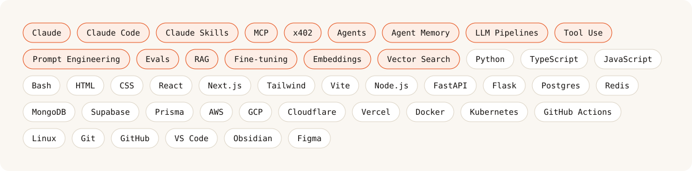

<picture>
  <source media="(prefers-color-scheme: dark)" srcset="assets/banner-dark.svg?v=3" />
  
</picture>

  
  
  
  

 

<table>
<tr>
<td width="50%" valign="top">

#### ◐ Now
**[Flashpoint.ai](https://flashpoint.ai)** at Natural Language Labs. I run engineering on professional-grade market research, built AI-native: quantitative, qualitative and behavioral methods in one study you can field in an afternoon instead of weeks.

</td>
<td width="50%" valign="top">

#### ◑ About
A decade of building: I've started companies, been an early engineer helping others scale, and led engineering teams. I'm the person teams bring in when the hard part isn't the code, but knowing what to build and making it feel right.

</td>
</tr>
<tr>
<td colspan="2">

#### ◒ Community
I run **[IXC Commons](https://raghavarora.com/ixc-commons)**, a builder community in Chandigarh. Small rooms, laptops open, everyone leaves with something that runs.

</td>
</tr>
</table>

 

### Open source

<table>
<tr>
<td width="50%" valign="top">

**[🧠 vault-skill](https://github.com/raghavaro/vault-skill)** 
Persistent project memory for Claude Code, kept as a local Obsidian-style vault of interlinked notes.

</td>
<td width="50%" valign="top">

**[🚀 claude-cofounder](https://github.com/raghavaro/claude-cofounder)** 
A Claude Code skill that runs a solo founder through a cofounder-style workshop: pressure-test the idea, define the customer, hand off a brief.

</td>
</tr>
<tr>
<td width="50%" valign="top">

**[🗂 chromama](https://github.com/raghavaro/chromama)** 
AI-driven Chrome tab & session manager. Reorganizes a thousand tabs by topic to win back the RAM and attention they cost.

</td>
<td width="50%" valign="top">

**[🧩 skillstack](https://github.com/ixccommons/skillstack)** 
From IXC Commons.

</td>
</tr>
</table>

### Also built

| | |
|---|---|
| **[Hyperproductive](https://hyperproductive.co)** | Private, invite-only productivity app. Hit me up for an invite. |
| **[BillKeeper Pro](https://billkeeper.pro)** | Bills, organized automatically. |
| **[LearnSomethin](https://learnsomethin.com)** | One new thing in your inbox every morning. |
| **[GitJack](https://www.gitjack.com)** | See what's moving in a repo. |

### Speaking

Same subject from different angles: what it takes to stop prompting a model and start running a system.

- *AI as a Co-Founder*, Startup Jharkhand
- *The Innovator's Address*, Chitkara University
- *Clay in Chandigarh*, Clay Clubs

### Stack

<picture>
  <source media="(prefers-color-scheme: dark)" srcset="assets/stack-dark.svg" />
  
</picture>
